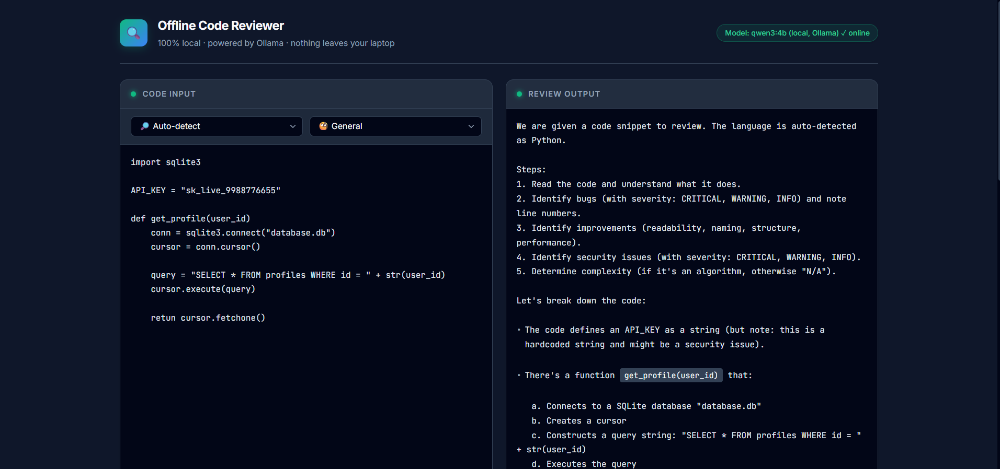

# Offline Code Reviewer

> Code review powered by a local open-weight AI model, so your private code never leaves your laptop.

---

## The Problem

Cloud AI code-review tools upload your code to someone else's servers. For private, proprietary, or sensitive codebases this is often unacceptable — you have no control over how that code is stored, logged, or used for training. Running the model locally removes that risk entirely.

---

## What I Built During the Hack Day

- **Streaming review UI** — results appear word-by-word as the model generates them, with no page reload
- **Language selector** — choose from auto-detect, Python, JavaScript, TypeScript, Java, C, C++, Go, Rust, SQL, Bash, or Git Diff
- **Review focus selector** — General, Bugs, Security, or Performance
- **"Load sample" button** — loads a short Python snippet with three intentional bugs (SQL injection, hardcoded password, off-by-one error) so you can see the tool in action immediately
- **`GET /health` endpoint** — checks whether Ollama is reachable and whether `qwen3:4b` is installed, returns `{ ollama_running, model, model_installed }`
- **Live model status in the page header** — polls `/health` on load and every 30 seconds; shows "online" in green or a clear instruction to run `ollama serve` in red if Ollama is not reachable
- **Agent Skill** — `skills/code-review/SKILL.md` follows the Agent Skills open standard so AI coding assistants can load and apply the same review logic

---

## Demo



---

## The AI Model

| | |
|---|---|
| **Model** | Qwen3-4B — approximately 4 billion parameters |
| **Size class** | Within the 10B small-model limit |
| **Local runtime** | [Ollama](https://ollama.com), model tag `qwen3:4b` |
| **Model card** | https://huggingface.co/Qwen/Qwen3-4B |
| **License** | Apache 2.0 (verify at the model card link above) |
| **Cloud APIs** | None. No API keys are used anywhere in this project. |

---

## How the AI Is Used

The backend (`main.py`) sends every review request to Ollama's local `/api/chat` endpoint. A fixed system prompt instructs the model to act as a senior code reviewer and to respond in exactly five sections: **Summary**, **Bugs**, **Improvements**, **Security**, and **Complexity**. The `/no_think` directive at the top of the system prompt suppresses chain-of-thought tokens on models that support it.

Key settings (from `main.py`):

- `temperature: 0.2` — keeps responses factual and consistent
- `num_ctx: 4096` — context window passed to Ollama
- Input truncated to **6 000 characters** before being sent to the model
- `stream: True` — Ollama streams JSON lines back to FastAPI, which forwards them as plain text to the browser via a `StreamingResponse`; the frontend reads the stream with the Fetch API and renders each chunk as it arrives

---

## Key Dependencies

| Package | What it does |
|---|---|
| [FastAPI](https://fastapi.tiangolo.com) | Web framework; serves the HTML frontend and the `/review` and `/health` endpoints |
| [Uvicorn](https://www.uvicorn.org) | ASGI server that runs FastAPI |
| [httpx](https://www.python-httpx.org) | Async HTTP client used to talk to Ollama from the backend |
| [Ollama](https://ollama.com) | Runs the Qwen3-4B model locally; installed separately, not a Python package |

---

## Getting Started

### Prerequisites

- Python 3.9 or later
- [Ollama](https://ollama.com/download) installed and running

### Windows (PowerShell)

```powershell
# 1. Install Ollama from https://ollama.com/download, then pull the model
ollama pull qwen3:4b

# 2. Clone the repo and enter the directory
git clone https://github.com/Krishna-Hyper/offline-code-reviewer.git
cd offline-code-reviewer

# 3. Install Python dependencies
pip install -r requirements.txt

# 4. Start the server
python -m uvicorn main:app --reload

# 5. Open your browser
start http://localhost:8000
```

### macOS / Linux

The same commands work in any terminal. Replace `start` in step 5 with `open` (macOS) or `xdg-open` (Linux), or just navigate to `http://localhost:8000` manually.

---

## Agent Skill

`skills/code-review/SKILL.md` follows the [Agent Skills open standard](https://developers.googleblog.com/en/agent-skills-open-standard/). It contains YAML frontmatter (`name`, `description`, `license`, `metadata`) that AI coding assistants use to discover and activate the skill, followed by markdown instructions that mirror the system prompt in `main.py`: the five-section output format, the four review focus modes, the `/no_think` and temperature constraints, and the 6 000-character input limit.

---

## Project Structure

```
offline-code-reviewer/
├── main.py                    # FastAPI backend: /review, /health, and / endpoints
├── index.html                 # Single-file frontend with streaming UI
├── requirements.txt           # Python dependencies (fastapi, uvicorn, httpx)
├── skills/
│   └── code-review/
│       └── SKILL.md           # Agent Skill definition
├── docs/
│   └── screenshot.png         # Screenshot for this README
└── README.md
```

---

## Limitations

- A 4-billion-parameter model can miss bugs, produce incorrect analysis, or hallucinate line references. It is a first-pass aid, not a replacement for human code review.
- Performance depends on your hardware. On laptops with limited GPU memory the model may run slowly or fall back to CPU inference.
- The input is truncated at 6 000 characters, so very large files will not be reviewed in full.

---

## License

This project is MIT licensed. See [LICENSE](LICENSE).

---

## Acknowledgements

Built at a Hacktoberfest Hack Day. Powered by [Qwen3](https://huggingface.co/Qwen/Qwen3-4B) and [Ollama](https://ollama.com).
